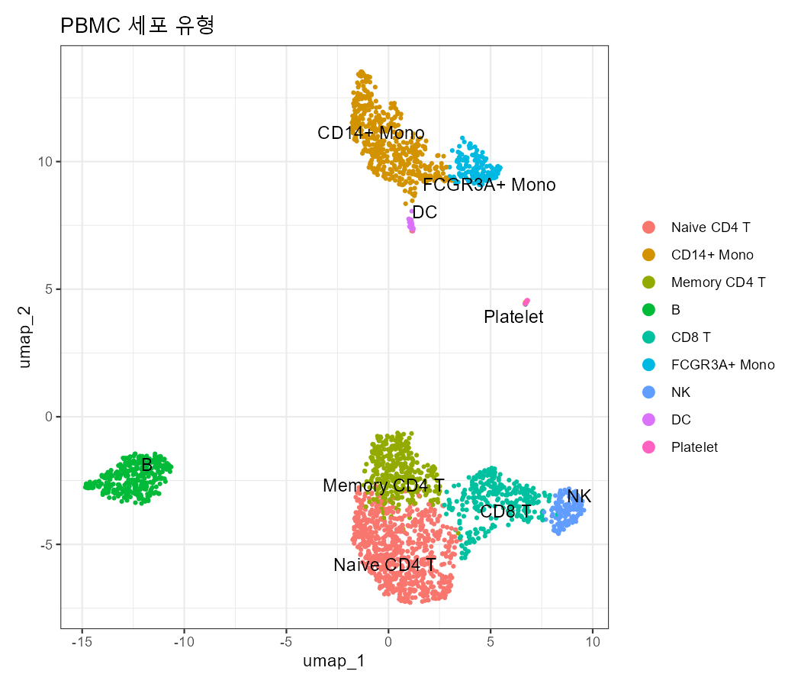

# PBMC 단일세포 전사체로 혈액 면역세포 구분하기

**질문:** 공개 단일세포 데이터 하나를 QC부터 세포 유형 주석까지 분석할 때, 각 단계의 기준을 데이터로 어떻게 정하고 확인할 수 있는가? 그리고 1000 Genomes에서 사람 집단을 가른 PCA는 세포 집단에서 무엇을 가르는가?

- 세포 2,700개 중 2,511개를 남겨 9개 세포 유형(Naive CD4 T, Memory CD4 T, CD8 T, NK, B, CD14+ 단핵구, FCGR3A+ 단핵구, 수지상세포, 혈소판)으로 구분했다.
- 유전자 수 상한, PC 개수, resolution은 그림 하나로 정하지 않고 다른 방법으로 한 번 더 확인했다. doublet 탐지 도구로 크기 기준이 놓친 doublet 127개를 추가로 찾았고, elbow plot에 묻혀 있던 수지상세포(전체의 1%)를 PC별 히트맵에서 찾아 PC를 9개로 정했다.
- PCA의 첫 번째 축은 1000 Genomes에서 아프리카와 나머지 집단을, 여기서는 단핵구와 림프구를 갈랐다.

이 데이터는 Seurat 공식 튜토리얼에 쓰이는 데이터이고, QC 기준(유전자 200–2,500, 미토콘드리아 5%)과 resolution 0.5는 튜토리얼 값과 같다. 이 저장소의 목적은 같은 값을 받아 적는 것이 아니라, 각 값을 직접 정하고 그 근거를 확인하는 과정을 연습하는 것이다. 튜토리얼과 다르게 한 부분(doublet 제거, PC 개수를 정한 방법, resolution 비교, 가설 확인)은 아래에 따로 적었다.

---

## 데이터와 도구

- **데이터:** 10x Genomics PBMC 3k (건강한 공여자 1명의 말초혈액 단핵세포, hg19). 유전자 32,738개 × 세포 2,700개, 세포당 검출 유전자 중앙값 817, UMI 중앙값 2,197
- **도구:** R 4.4.3, Seurat 5.5.0, scDblFinder 1.20.2, tidyverse
- **최종 데이터:** 유전자 13,714개(세포 3개 이상에서 검출) × 세포 2,511개, 변이가 큰 유전자 2,000개, PC 9개, resolution 0.5

## 판단과 근거

### 판단 1. 미토콘드리아 비율 5% 미만만 남겼다

- 미토콘드리아 비율 중앙값 2.03%, 99%가 5.88% 이하. 비율이 높은 세포는 UMI가 적은 쪽에 몰려 있었다(세포막이 터진 세포의 패턴, [그림 2](results/figures/fig2_qc_scatter.png) 오른쪽).
- 10%로 바꾸면 탈락이 57개 → 6개. 5–10% 사이 51개(2%)는 잃는 것이 적고 남기면 이상한 군집을 만들 위험이 있어 5%로 정했다.
- 다른 지표로 확인: 미토콘드리아 비율이 아주 높은 세포는 리보솜 유전자 비율이 낮았다([그림 2b](results/figures/fig2b_ribo.png)).

### 판단 2. 유전자 수 상한 2,500 + doublet 탐지 도구로 doublet 127개를 추가로 뺐다

- 상한을 2,000 / 2,500 / 3,000으로 옮기면 남는 세포 2,635 / 2,638 / 2,641([표 2](results/tables/table2_qc_sensitivity.csv)). [그림 2](results/figures/fig2_qc_scatter.png) 왼쪽에서 3,000 쪽 틈이 더 넓어 보였지만, 꼬리 구간이라 틈만으로는 정할 수 없었다.
- scDblFinder로 확인: 2,500 이상 5개가 모두 doublet(2,700 근처 3개 포함) → 2,500으로 정했다.
- scDblFinder 판정 doublet 133개(4.9%) 중 128개(96%)는 유전자 수 기준에 걸리지 않았다. 작은 세포 두 개가 합쳐지면 정상 세포 크기 범위에 들어가기 때문이다([그림 2c](results/figures/fig2c_doublets.png)).
- doublet은 T세포·단핵구 마커 동시 검출 비율 2.2배(24% → 52%), 미토콘드리아 비율은 정상. 기존 QC로 빠지지 않은 127개를 추가로 뺐다.

### 판단 3. PC는 9개를 썼다

- [Elbow plot](results/figures/fig4a_elbow.png): 7 근처에서 꺾임(설명 분산 PC7 1.71%, PC8 1.48%, PC9 1.40%, PC10 1.39%).
- [PC별 히트맵](results/figures/fig4c_pc_heatmaps.png): PC8 = 수지상세포 마커(CD1C, FCER1A), PC9 = 인터페론 반응(IFIT2, MX1, IRF7), PC10부터 흐려짐.
- 수지상세포는 1%뿐이라 분산이 작아 elbow에서 묻힌다. 9개로 정했고, 수지상세포는 군집화에서 따로 잡혔다.

### 판단 4. resolution은 0.5를 골랐다

0.3, 0.5, 0.8, 1.2를 모두 돌려 비교했다([표 4](results/tables/table4_resolution.csv), [그림 5a](results/figures/fig5a_umap_resolutions.png), [그림 5b](results/figures/fig5b_cluster_splits.png)).

| resolution | 군집 수 | 가장 작은 군집 | 가장 큰 군집 |
|---|---|---|---|
| 0.3 | 7 | 25 | 1,087 |
| 0.5 | 9 | 14 | 713 |
| 0.8 | 11 | 14 | 466 |
| 1.2 | 12 | 14 | 339 |

- 0.3은 혈소판 14개를 UMAP에서 멀리 떨어져 있는데도 단핵구 군집에 붙였다. 세포 수가 적은 집단은 resolution이 낮으면 따로 세워지지 않는다.
- 0.5부터 혈소판(14개)과 수지상세포(25개)가 따로 잡혔고, 이 두 군집과 B세포(332개), NK세포(137개)는 0.8, 1.2에서도 같은 세포 그대로 유지됐다.
- 0.5 → 0.8에서는 가장 큰 T세포 군집(713개)이 376 + 193 + 133개로 실제로 쪼개졌고, 0.8 → 1.2는 대부분 경계 세포가 옆 군집으로 옮겨 간 것이었다.
- 0.5의 군집 수(9개)는 PBMC에서 기대하는 세포 유형 수와 같았다. 다만 개수가 같다는 것만으로 1:1이라고 보지 않고, 군집마다 마커로 확인했다.

### 판단 5. 데이터가 찾은 마커와 알려진 마커를 교차 확인해 이름을 붙였다

- 데이터 마커(`FindAllMarkers`, [표 6](results/tables/table6_top_markers.csv), [히트맵](results/figures/fig7a_marker_heatmap.png))와 알려진 마커([dot plot](results/figures/fig7b_known_markers_dot.png))가 같은 세포를 가리킬 때 이름을 붙였다.
- 처음에는 1번을 Memory CD4 T(S100A4), 4번을 NK(NKG7)로 잘못 봤다. S100A4는 단핵구·NK에서도, NKG7은 CD8 T에서도 켜진다. CD3E(T세포인가) → CD8A → CCR7 vs S100A4 순서로 다시 읽어 고쳤다.

| 군집 | 이름 | 결정적인 마커 | 세포 수 (비율) |
|---|---|---|---|
| 0 | Naive CD4 T | CD3E, IL7R, CCR7, TCF7, LEF1 | 713 (28.4%) |
| 1 | CD14+ Mono | CD14, S100A8, S100A9, LYZ | 468 (18.6%) |
| 2 | Memory CD4 T | CD3E, IL7R, S100A4, CD40LG | 368 (14.7%) |
| 3 | B | MS4A1, CD79A | 332 (13.2%) |
| 4 | CD8 T | CD3E, CD8A, GZMK | 300 (11.9%) |
| 5 | FCGR3A+ Mono | FCGR3A, MS4A7, LILRA3 | 154 (6.1%) |
| 6 | NK | GNLY, GZMB, KLRF1 (CD3E 거의 없음) | 137 (5.5%) |
| 7 | DC | FCER1A, CD1C, CLEC10A | 25 (1.0%) |
| 8 | Platelet | PPBP, GP9, ITGA2B | 14 (0.6%) |

혈소판, B, 수지상세포, CD14+ 단핵구는 마커가 다른 세포에서 거의 켜지지 않아 확신이 높다(예: GP9은 혈소판의 93%, 나머지 세포의 0.1%에서 검출). Naive와 Memory CD4 T는 구별 마커의 차이가 작고(CCR7 avg_log2FC 2.46) UMAP 경계가 섞여 있어 확신이 상대적으로 낮다. T세포는 Naive에서 Memory로 연속적으로 바뀌어 가므로 경계 근처 세포의 분류는 확실하지 않다.

## 예측과 결과

군집과 이름이 정해지기 전에 세운 예측을, 이름을 붙인 뒤 확인했다([표 7](results/tables/table7_hypotheses.csv), [그림 7d](results/figures/fig7d_hypotheses.png)).

| 언제 | 예측 | 결과 | 이유 |
|---|---|---|---|
| QC | 리보솜 비율 분포의 몸통 2개는 림프구(높음)와 단핵구(낮음), 아래로 떨어진 점은 혈소판 | **일부 틀림.** 높은 쪽은 CD4 T·B(40–45%), 낮은 쪽은 단핵구 **와 NK**(19–25%), 혈소판 2.3%. CD8 T는 33%로 중간 | 리보솜 비율은 mRNA 중 리보솜 유전자의 몫이다. NK는 림프구지만 세포를 죽이는 단백질 유전자(GZMB, GNLY, NKG7)를 많이 켜서 몫이 줄었다. 단핵구가 LYZ, S100A8 때문에 낮은 것과 같다 |
| 군집화 | RNA가 많은 5번 군집은 FCGR3A+ 단핵구이거나 남은 doublet | FCGR3A+ 단핵구 | 자기만의 마커(FCGR3A, MS4A7)가 있고, T세포 마커는 없어 서로 다른 세포가 섞인 모습이 아니다 |
| PCA | PC9(인터페론 반응)를 넣으면 같은 세포가 반응 여부로 갈라진 "상태 군집"이 생길 수 있다 | **생기지 않았다.** 반응 세포는 자기 세포 유형 군집 안에 섞여 있었고, 특히 CD14+ 단핵구에 많았다(점수 상위 5% 세포가 군집의 12.6%, 기대치의 약 2.5배) | 세포 유형 사이에는 수백 개 유전자가, 반응 여부 사이에는 인터페론 유전자 수십 개가 다르다. 단핵구는 선천 면역의 최전선이라 인터페론에 민감하다 |
| PCA | PC1–PC2에서 세포가 세 덩어리로 나뉜다 | 맞음. PC1은 단핵구 vs 림프구, PC2는 B세포 vs NK·세포독성 세포 | [그림 6](results/figures/fig6_pca_vs_umap.png). T세포 하위 집단, 수지상세포, 혈소판을 가르는 정보는 PC3–9에 있어 PC1–PC2 그림에서는 겹쳐 보인다 |

세포 유형 비율([표 8](results/tables/table8_cell_types.csv))은 T세포 55.0%, 단핵구 24.7%, NK 5.5%, B 13.2%, 수지상세포 1.0%로, 건강한 사람 PBMC의 대략적인 범위(T 45–70%, 단핵구 10–20%, NK 5–15%, B 5–10%, 수지상세포 1–2%)와 크게 어긋나지 않았다. 공여자가 1명이고 QC에서 빠진 세포가 세포 유형마다 고르지 않을 수 있어, 비율로 결론을 내리지는 않는다.

## 1000 Genomes 분석과 비교

[1000 Genomes 분석](https://github.com/Inseong-Park/human-diversity-1kg)과 같은 방법(PCA)을 다른 해상도의 데이터에 썼다.

| | 1000 Genomes | PBMC |
|---|---|---|
| 한 행 | SNP | 유전자 |
| 한 열 | 사람 2,491명 | 세포 2,511개 |
| 값 | 유전형 0, 1, 2 (정해진 값) | UMI 개수 (측정한 값, 대부분 0) |
| 열 단위로 맞추기 | 필요 없음 | 세포마다 총량 10,000으로 맞추고 log(1 + x) |
| 정보 있는 변수 고르기 | MAF 0.05, LD pruning → SNP 8,551개 | 변이가 큰 유전자 2,000개 |
| 행 단위로 맞추기 | PLINK `--pca`가 자동으로 | `ScaleData`로 직접 |
| PC1이 가른 것 | 아프리카 vs 나머지 | 단핵구 vs 림프구 |
| 기준을 바꿔 본 것 | 친척 제외, MAF, LD pruning, 혼혈 집단 | 미토콘드리아 비율, 유전자 수 상한, PC 개수, resolution |

사람 집단에서 데이터 전체의 가장 큰 차이는 조상(대륙)이었고, 세포 집단에서는 세포 종류였다.

## 한계와 다음 질문

- **공여자 1명:** 세포가 2,511개여도 독립된 표본은 1명이다. 세포 유형 비율이나 인터페론 반응 정도를 사람 사이 차이로 일반화할 수 없다.
- **주변 RNA를 보정하지 않았다:** 단핵구에서 아주 많이 만들어지는 LYZ가 T세포·B세포에서도 1–3개씩 잡혔다. 터진 세포에서 흘러나온 RNA가 모든 방울에 섞인 것으로, SoupX 같은 보정이 필요하다. 그래서 마커 하나가 검출된 것만으로 세포 유형을 정하지 않았다.
- **같은 종류끼리 합쳐진 doublet:** T세포 + T세포처럼 같은 종류의 doublet은 발현 패턴이 같아 scDblFinder로도 잘 찾지 못한다.
- **10x 데이터의 dropout:** CD8A는 CD8 T 세포의 46%에서만 검출됐다. 검출되지 않은 것이 발현되지 않은 것은 아니다.
- **기준을 바꿔 본 검증:** MT 기준(5% → 10%), doublet 제거 여부, PC 개수(7 / 10), resolution(0.8)을 하나씩 바꿔도 세포의 92–97%가 같은 이름을 받았다. 다만 PC를 7개로 줄이면 수지상세포가 단핵구와 합쳐져 사라졌고, doublet을 남기면 Memory CD4 T 군집이 오염되었다. 자세한 내용은 [notes.md](notes.md) Day 5에 있다.

이 분석은 세포 종류를 나누는 데까지 왔다. 1000 Genomes에서 본 집단 사이의 유전적 차이가 **어떤 세포에서** 유전자 발현의 차이로 나타나는지 보려면, 여러 공여자의 단일세포 데이터에서 공여자를 표본 단위로 삼아 분석해야 한다.

## 재현 방법

`data/`와 `work/`는 저장소에 포함하지 않았다. RStudio에서 `pbmc-scrna.Rproj`를 연 뒤 아래 순서로 실행한다. 스크립트마다 `▶ 직접 정할 값`으로 표시한 곳은 이 분석에서 정한 값이 저장되어 있다.

| 순서 | 스크립트 | 하는 일 | 정한 값 |
|---|---|---|---|
| 1 | `R/00_setup.R` | Seurat 설치, PBMC 3k 다운로드 | |
| 2 | `R/01_qc.R` | QC 지표, 기준별 민감도 (그림 1–2, 표 1–2) | 유전자 200–2,500, MT 5% |
| 3 | `R/01b_qc_extra.R` | 리보솜 비율, scDblFinder (그림 2b–2d) | doublet 제거 |
| 4 | `R/02_pca.R` | 정규화, 변이 큰 유전자, PCA (그림 3–4, 표 3) | PC 9개 |
| 5 | `R/03_cluster.R` | resolution 4개 비교, UMAP (그림 5–6, 표 4–5) | resolution 0.5 |
| 6 | `R/04_annotate.R` | 마커, 이름 붙이기, 가설 확인 (그림 7–8, 표 6–8) | 세포 이름 9개 |
| 7 | `R/05_robustness.R` | 기준을 하나씩 바꿔 다시 분석 (그림 9–10, 표 9–12) | 기준 모두 유지 |

`01b_qc_extra.R`은 Bioconductor 패키지가 필요하다: `BiocManager::install(c("scDblFinder", "SingleCellExperiment"))`. 단계마다 무엇을 보고 어떻게 판단했는지, 틀린 예측과 그 이유는 [notes.md](notes.md)에 있다.
